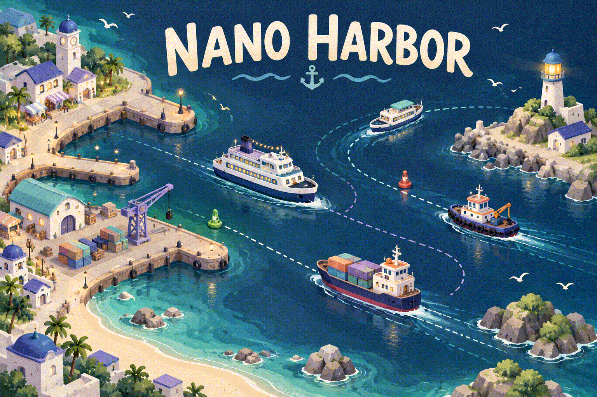

# ⚓ Nano Harbor

## [▶ Play Nano Harbor](https://maomaxgame.github.io/Nano-Harbor/)

### Little boats. Busy waters. Your harbor.

**Free to play in your browser. No download. No account.**

Welcome to Crescent Bay! Guide ferries and cargo ships through shared waters, keep your docks moving, and grow a tiny port into a thriving harbor. Every safe arrival helps keep the lights on.

### A little harbor to look after

- 🚢 **Guide the traffic** — draw safe routes for passenger ferries, cruise ships, tankers, and cargo ships.
- ⚓ **Keep things moving** — match boats to their docks, then send them back out to sea.
- 🛟 **Help boats in trouble** — send repair crews where they are needed.
- 🏗️ **Grow your port** — build docks, improve your crews, and manage your cash.
- 🌦️ **Watch the water** — plan around changing weather and a growing fleet.
- 🎵 **Settle into the soundscape** — ocean ambience, harbor sounds, and gentle music.

### Your first arrival

1. Open the game and follow the short tutorial.
2. Select a boat, then click or tap its matching dock. Drag from a boat to draw your own route.
3. Once service finishes, guide it to a sea exit and welcome the next arrival.

**Need a moment?** Pause anytime to plan. Open **Harbor** for boat commands, repairs, building, and settings. Mouse, touch, and keyboard controls are supported.

---

Made by [maomaxgame](https://github.com/maomaxgame) · [Play now](https://maomaxgame.github.io/Nano-Harbor/) · [Report a bug](https://github.com/maomaxgame/Nano-Harbor/issues)

Licensed under [PolyForm Noncommercial 1.0.0](https://maomaxgame.github.io/Nano-Harbor/LICENSE). Bundled audio is [CC0](https://maomaxgame.github.io/Nano-Harbor/audio/ATTRIBUTION.md).
